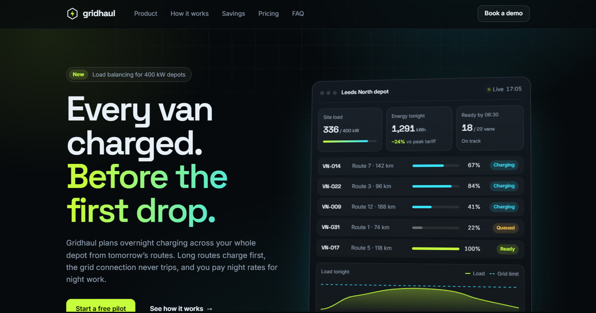

# Gridhaul

A product landing page for a fictional software company that schedules overnight EV charging for delivery-van fleets.
Dark interface with electric lime and cyan accents, glass panels and a live product mock-up.

**Live site:** https://minty-web.github.io/2/



## What's inside

- **Live dashboard mock-up** built in HTML/CSS: vans charge, queue and turn "Ready" in real time while site load and energy counters update
- **Savings calculator** with four sliders (fleet size, daily distance, electricity and diesel price) that estimates monthly and yearly savings and CO₂ avoided
- **Pricing toggle** (monthly / yearly) built as an accessible switch
- **FAQ accordion** with animated panels and proper `aria-expanded` state
- Feature cards with a glow that follows the pointer, count-up stats, reveal-on-scroll
- Email sign-up with validation (demo only, nothing is sent)
- Fully responsive, keyboard friendly, respects reduced motion

## Built with

Plain HTML, CSS and JavaScript. No frameworks, no build step.
Fonts: [Space Grotesk](https://fonts.google.com/specimen/Space+Grotesk) and [Inter](https://fonts.google.com/specimen/Inter).

```
index.html    page structure and content
styles.css    design tokens, layout and animations
script.js     dashboard simulation, calculator, pricing, FAQ
favicon.svg   logo mark
```

## Run it locally

Open `index.html` in a browser, or serve the folder:

```bash
npx serve .
```

---

Gridhaul and every customer shown are made up. Concept site designed and built by [minty-web](https://github.com/minty-web).
